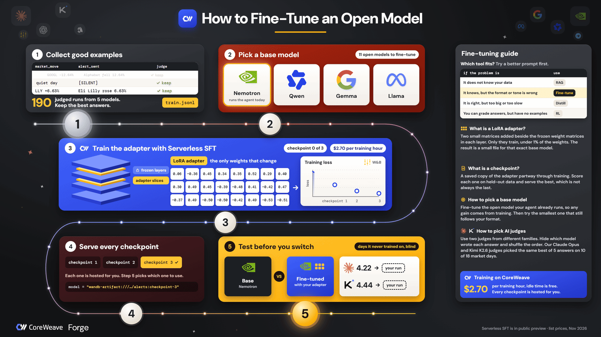
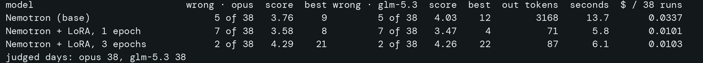
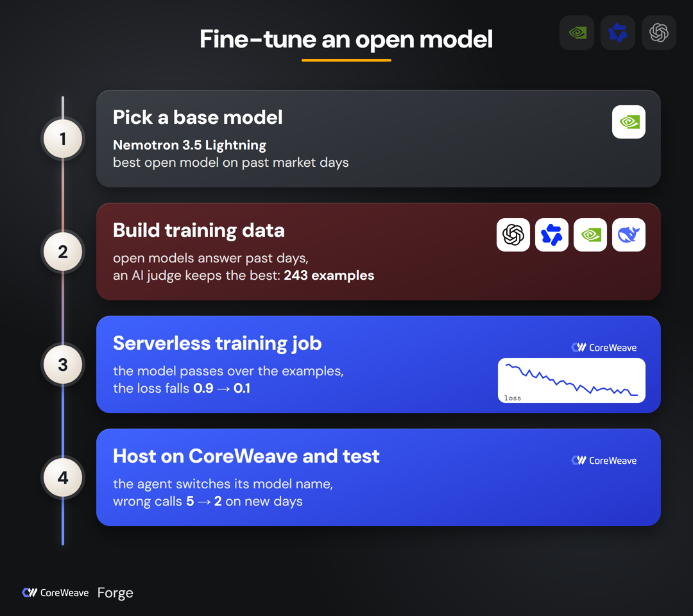
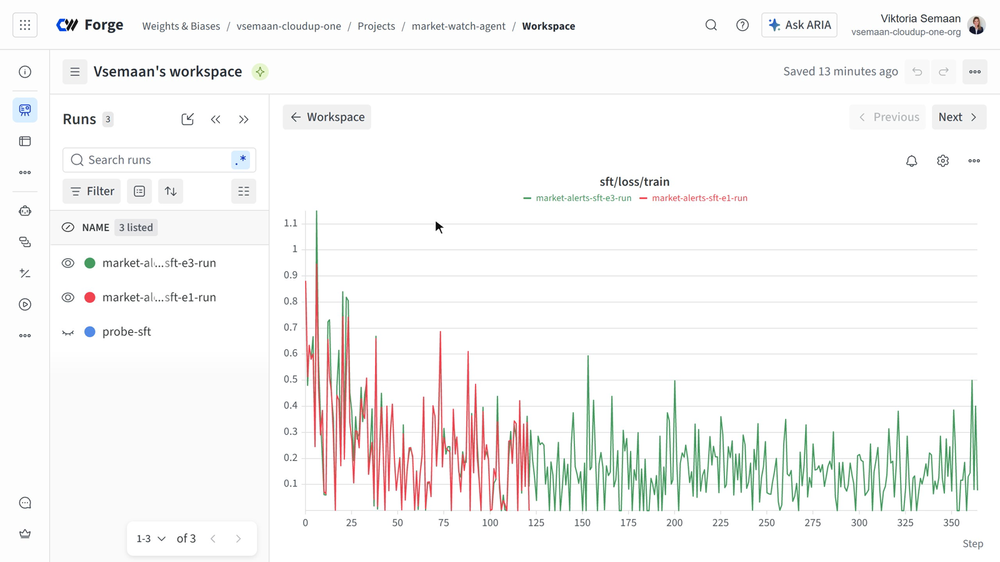
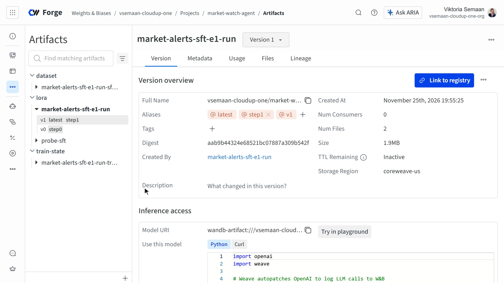

# Fine-Tune an Open Model for Your Agent on CoreWeave

This tutorial takes the always-on market agent from the [Market Watch Agent Tutorial](../Market%20Watch%20Agent%20Tutorial/)
and makes its model better at the one job it does. The agent runs on NVIDIA Nemotron 3.5 Lightning, an open-weight
model on CoreWeave Serverless Inference. On 38 past market days it made 5 wrong calls: it sent an alert when it should
have stayed quiet, or stayed quiet when something mattered. After fine-tuning with CoreWeave Serverless SFT, the same
model made 2 wrong calls on those days, and each run became three times cheaper.

<p align="center"></p>

## What you'll learn

1. **When fine-tuning is worth it,** and when a better prompt or a different model is enough.
2. **How to build training data without writing it by hand.** Several open models answer past days, and an AI judge
   keeps only the best answers.
3. **How to train a LoRA adapter on CoreWeave Serverless SFT** with one command, and follow the training in Forge.
4. **How to switch your agent to the new model** by changing one model name.
5. **How to test it fairly** on days it never saw, with two AI judges scoring blind.

## The results

The same agent (Hermes), the same instructions and the same 38 market days (Aug 24 to Nov 16, 2026). None of these
days were used for training. Two AI judges scored every answer without seeing which model wrote it.

<p align="center"></p>

| Model | Wrong calls (Claude Opus judge) | Wrong calls (GLM 5.3 judge) | Picked as best answer (Opus / GLM) | Output tokens per run | Seconds per run | Cost of 38 runs |
|---|---|---|---|---|---|---|
| Nemotron 3.5 Lightning (base) | 5 of 38 | 5 of 38 | 9 / 12 | 3,168 | 13.7 | $0.0337 |
| Nemotron + LoRA, 1 epoch | 7 of 38 | 7 of 38 | 8 / 4 | 71 | 5.8 | $0.0101 |
| **Nemotron + LoRA, 3 epochs** | **2 of 38** | **2 of 38** | **21 / 22** | **87** | **6.1** | **$0.0103** |

What this shows:

- **Fewer mistakes.** The 3-epoch model made less than half the wrong calls of the base model, and both judges agree.
- **One pass was not enough.** After one epoch the model had already learned the short answer format, but not yet
  when to alert, so it got worse. After three passes it got better. Always test before you switch.
- **Shorter answers, lower cost.** The base model writes a long reasoning trace before every answer. The trained
  model learned to answer directly, so it uses about 36 times fewer output tokens and runs twice as fast.
- **No new mistakes in the facts.** The judges' accuracy score, which drops when an answer invents a number, stayed the
  same as the base model's (Opus: 4.50 vs 4.63, GLM: 4.50 vs 4.47).

38 days is a small test, so read the numbers as a clear direction rather than a precise rate. The cost per run assumes
the trained adapter is billed at base Nemotron's price, because Forge publishes no separate price for hosted adapters.

## When to fine-tune

| Your problem | Try first | Why |
|---|---|---|
| The model doesn't know your facts | RAG: put the facts in the prompt | Facts change; training would freeze them |
| The answers are close, but the format or style is off | A better prompt, then fine-tuning | Fine-tuning is great at format and habits |
| The model makes the same kind of wrong decision again and again, and you have examples of the right one | **Fine-tuning** | This tutorial's case: the agent alerted on routine paperwork or missed real news |
| A bigger model does the job and a smaller one should copy it | Distillation | A teacher model writes the examples |
| You can score answers but have no examples | Reinforcement learning | The model learns from scores, not from examples |

## How it works

<p align="center"></p>

1. **Pick a base model.** In the first tutorial, five models answered the same 38 days and two judges scored them.
   Nemotron 3.5 Lightning was the best open model. We keep it, and teach it with examples.
2. **Build training data.** Fine-tuning needs examples of the right answer, and nobody had written them. So the agent
   replayed 121 earlier market days (Jan 2 to Aug 21, 2026), and four open models each wrote that day's alert: 484
   answers. An AI judge scored every answer against the user's preferences and kept only the perfect ones: 243 examples.
3. **Train on CoreWeave Serverless SFT.** One command uploads the examples and starts the job. CoreWeave's GPUs train a
   small LoRA adapter (1.9 MB) next to the frozen base model, and Forge shows the training loss falling.
4. **Host it and test it.** CoreWeave hosts every trained adapter right away, with no server to deploy. The agent
   switches its model name, runs the 38 test days, and the judges score old and new answers side by side.

Why we kept Claude out of the training data: Anthropic's terms don't allow using Claude's outputs to train other models.
Claude Opus appears in this tutorial only as a judge of the final test, never as a source of examples.

## Prerequisites

- The [Market Watch Agent Tutorial](../Market%20Watch%20Agent%20Tutorial/) working: Hermes Agent with the `marketwatch`
  profile, the gateway, and your CoreWeave Forge key in `~/.config/coreweave/forge_key`.
- **A Models seat in Forge.** Serverless SFT logs every training run to W&B Models. In Forge, open your account menu →
  Users, and set your Models seat to **Full** (the Free plan includes 5 seats). Without it, registering a model times
  out with HTTP 524.
- Python 3.10 or later and [uv](https://docs.astral.sh/uv/) (or pip) for the training environment.
- Optional: an Anthropic API key for the Claude Opus judge in the final test. The GLM 5.3 judge on CoreWeave alone is
  enough.

All commands below run from this folder (`Fine-Tune an Open Model Tutorial`) unless a step says to `cd` into the agent
folder.

## Step 1 · Get more market days

The agent's pre-check uses Alpha Vantage's free plan, which covers the last 100 trading days. That was enough to compare
models, but too few to train one. This script downloads about two years of daily closing prices from Yahoo Finance's
public chart data (no key) and saves them next to the agent's cache. The pre-check then uses them for older days.

```bash
python3 scripts/fetch_history.py
```

Then list the days that wake the model, and split them by time. Training days come first, test days later, so the
test never sees the future:

```bash
python3 scripts/event_days.py --start 2026-01-02 --end 2026-08-21 > "../Market Watch Agent Tutorial/data/train_days.txt"   # 121 days
python3 scripts/event_days.py --start 2026-08-24 --end 2026-11-16                                                       # the 38 test days
```

## Step 2 · Collect answers from four open models

The agent replays each training day through Hermes, once per model, with the gateway recording every call. Start the
gateway and the agent's scheduler first, as in the first tutorial:

```bash
cd "../Market Watch Agent Tutorial"
python3 gateway/proxy.py &
marketwatch gateway start
COMPARE_OUT=results/compare-train python3 eval/compare.py \
  --models openai/gpt-oss-120b nvidia/NVIDIA-Nemotron-3.5-Lightning-30B-A3B Qwen/Qwen3.6-35B-A3B deepseek-ai/DeepSeek-V4.1-Flash \
  --days $(cat data/train_days.txt)
```

Each run takes about 45 seconds, so 484 runs take a while. To go faster, clone the profile and run one model per
profile in parallel (`hermes profile create mwa --clone-from marketwatch --no-alias`, then
`HERMES_PROFILE=mwa COMPARE_OUT=results/compare-train python3 eval/compare.py --models <one model> ...`).

## Step 3 · Keep only the best answers

An AI judge scores every day's answers side by side, blind and shuffled, against `hermes/USER.md` and `hermes/SOUL.md`:

```bash
JUDGE_OUT=results/judge-train-glm-5.3 COMPARE_OUT=results/compare-train \
  python3 eval/judge.py --judge zai-org/GLM-5.3 --tries 4
```

We picked GLM 5.3 after testing three open judges on the same 4 days. Kimi K2.6 used its whole 8,000-token budget on
thinking and returned no scores, or gave every answer 5 out of 5. GLM 5.3 and MiniMax M3 both returned valid scores
with a real spread. Their results are in `results/judge-train-kimi/` and `results/judge-train-minimax-m3/`.
`--tries 4` retries a day when the judge returns broken output or the server returns an error, and `--shard i/n` splits
the days across parallel processes.

Then turn the judged answers into training examples:

```bash
cd "../Fine-Tune an Open Model Tutorial"
python3 scripts/build_dataset.py --min 5
```

```text
243 examples from 117 days (94 are [SILENT])
    82  deepseek-ai/DeepSeek-V4.1-Flash
    70  openai/gpt-oss-120b
    51  Qwen/Qwen3.6-35B-A3B
    40  nvidia/NVIDIA-Nemotron-3.5-Lightning-30B-A3B
```

Each example is the exact request Nemotron received that day (the system prompt, the pre-check report, the tools),
taken from the gateway's log, plus one answer the judge scored 5 out of 5 with the right decision. The model learns
from what it will really see in production. The file is `data/train.jsonl`, one `{"messages": [...], "tools": [...]}`
per line.

## Step 4 · Train on CoreWeave Serverless SFT

Install [OpenPipe ART](https://github.com/OpenPipe/ART) and the W&B client, which ART uses to upload the training file:

```bash
uv venv ~/ft-venv && uv pip install --python ~/ft-venv/bin/python openpipe-art wandb
```

Start a short job first, to check that everything works, then the full one:

```bash
~/ft-venv/bin/python scripts/train_sft.py --epochs 1 --name market-alerts-sft-e1
~/ft-venv/bin/python scripts/train_sft.py --epochs 3 --name market-alerts-sft-e3
```

The script reads your Forge key from `~/.config/coreweave/forge_key`, registers a trainable model on
`nvidia/NVIDIA-Nemotron-3.5-Lightning-30B-A3B`, uploads `data/train.jsonl` as a W&B artifact and starts the job. It
trains in batches of 2 with a cosine learning-rate schedule peaking at 2e-4, on the last assistant turn of each
example. The 1-epoch job took about 6 minutes and the 3-epoch job about 9.

Follow the run in Forge: Weights & Biases → your project → Workspace → the run. Search the charts for `loss`:
`sft/loss/train` starts near 0.9 and falls toward 0.1 (it's noisy, because every batch holds only 2 examples).

<p align="center"></p>

The trained adapter appears under the run's **Artifacts** tab, with its model name and a "Try in playground" button:

<p align="center"></p>

## Step 5 · Switch the agent to the new model

Every checkpoint is hosted at `https://api.training.wandb.ai/v1` as soon as it's saved. The agent keeps talking to the
gateway, and the gateway maps a short model name to your checkpoint. Put your adapters' Model URIs in
`../Market Watch Agent Tutorial/data/trained_models.json`:

```json
{
 "nemotron-ft-e1": "wandb-artifact:///<your-team>/market-watch-agent/market-alerts-sft-e1-run:v1",
 "nemotron-ft-e3": "wandb-artifact:///<your-team>/market-watch-agent/market-alerts-sft-e3-run:v1"
}
```

Restart the gateway, and the agent can use `nemotron-ft-e3` like any other model. The gateway counts these calls
against the same monthly budget.

## Step 6 · Test on days it never saw

Run the 38 test days with the base model and both checkpoints, then score them with two judges:

```bash
cd "../Market Watch Agent Tutorial"
COMPARE_OUT=results/compare-test python3 eval/compare.py \
  --models nvidia/NVIDIA-Nemotron-3.5-Lightning-30B-A3B nemotron-ft-e1 nemotron-ft-e3 \
  --days $(python3 "../Fine-Tune an Open Model Tutorial/scripts/event_days.py" --start 2026-08-24 --end 2026-11-16)
JUDGE_OUT=results/judge-test-opus    COMPARE_OUT=results/compare-test python3 eval/judge.py
JUDGE_OUT=results/judge-test-glm-5.3 COMPARE_OUT=results/compare-test python3 eval/judge.py --judge zai-org/GLM-5.3 --tries 4
cd "../Fine-Tune an Open Model Tutorial"
python3 scripts/results.py
```

`results.py` prints the table at the top of this page: wrong calls and scores from each judge, how often each judge
picked the model's answer as the best, and output tokens, seconds and cost per run.

Why the base model has 5 wrong calls here and 3 in the first tutorial: the base model ran again for this test, next to
the fine-tuned models, and its answers vary from run to run. The fair comparison is the one where all three models ran
under the same conditions.

## What it cost

| What | Cost |
|---|---|
| Training, both jobs (Forge billing, W&B Training) | $0.57, covered by the $500 training allowance |
| 484 training answers from four open models | $0.41 |
| GLM 5.3 judging the 121 training days and the 38 test days, with retries | $3.87 |
| Judges we tried and dropped (Kimi K2.6, MiniMax M3) | $0.19 |
| The test runs of the fine-tuned models | $0.02 |
| Claude Opus judging the 38 test days (Anthropic API) | $0.78 |
| **Total** | **about $5.83** |

Repeating the tutorial without our detours costs about $4, and less if you skip the Opus judge.

## Troubleshooting

| What you see | Why | Fix |
|---|---|---|
| `TrainableModel.__init__() missing ... 'run_name'` | ART 0.5.24 needs a run name | `scripts/train_sft.py` already passes one |
| HTTP 524 after about 125 s when the model registers | Your user has no Models seat | Forge → account menu → Users → Models seat: Full |
| `ModuleNotFoundError: No module named 'wandb'` | ART uploads the training file with the W&B client | `uv pip install wandb` into the same environment |
| `error code: 1010` from the gateway on a trained model | Cloudflare blocks Python's default user agent on the training endpoint | `gateway/proxy.py` sends its own `User-Agent` |
| `ERR` on every fine-tuned run in `compare.py`, with a full answer | The trained-model endpoint fails to parse streaming responses; Hermes retries without streaming and gets the answer | Nothing to fix; the failed call costs nothing |
| The progress bar says `1/122 [03:01<6:05:38]` | The SFT job is one step on the server, so the estimate is meaningless | Wait for the final JSON; the job takes minutes |
| A judge returns no scores (`finish: length`) | Some models spend the whole token budget thinking | Use a different judge, or raise `max_tokens` in `eval/judge.py` |

## Limits

- 38 test days is a small test, and a model's answers vary from run to run. Run the test again before you trust a
  difference of one or two wrong calls.
- The examples come from open models judged by another open model. A judge can be wrong, and its mistakes become
  training data. Reading a sample of `data/train.jsonl` before training is worth the time.
- The market data covers the 10 largest S&P 500 companies in 2026. A different watchlist or a different market needs
  its own training days.

## What's in this folder

| Path | What it is |
|---|---|
| `scripts/fetch_history.py` | Step 1: two years of daily closes from Yahoo Finance |
| `scripts/event_days.py` | Steps 1 and 6: the days that wake the model between two dates |
| `scripts/build_dataset.py` | Step 3: judged answers → `data/train.jsonl` |
| `scripts/train_sft.py` | Step 4: the Serverless SFT job with OpenPipe ART |
| `scripts/results.py` | Step 6: the before-and-after table |
| `data/train.jsonl` | the 243 training examples |
| `data/dataset_report.json` | how many examples, from which models, how many silent |
| `data/trained_model.json`, `data/trained_model-e1.json` | what each training job returned (name, step, time) |
| `visuals/` | the diagrams and Forge screenshots on this page |

The runs and the scores live in the agent's `results/` folder: `compare-train/`, `judge-train-glm-5.3/`,
`compare-test/`, `judge-test-opus/` and `judge-test-glm-5.3/`. See its [README](../Market%20Watch%20Agent%20Tutorial/results/README.md).

## Clean up

- Stop the gateway and the Hermes gateways: `pkill -f gateway/proxy.py`, then `marketwatch gateway stop` (and the
  same for any cloned profiles).
- Delete cloned profiles you no longer need: `hermes profile delete mwa`.
- Trained adapters stay in your Forge project as artifacts. They count toward your storage (5 GB on the Free plan), and
  you can delete them from the run's Artifacts tab.

## Learn more

- [CoreWeave Serverless SFT](https://docs.coreweave.com/products/post-training/serverless-training/sft)
- [OpenPipe ART](https://github.com/OpenPipe/ART)
- [LoRA: Low-Rank Adaptation of Large Language Models](https://arxiv.org/abs/2106.09685)
