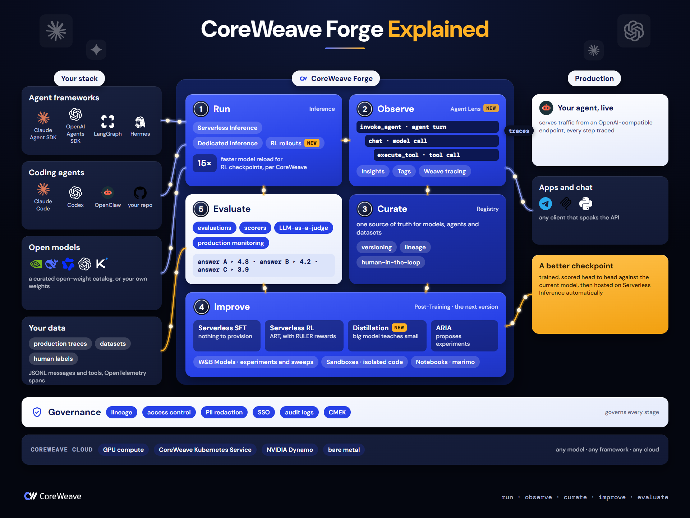

# ☁️ AI Cloud Tutorials

Hands-on projects that take AI agents from pilot to production with open models on an AI cloud. Each project is a
complete tutorial with code, setup steps, architecture diagrams and real results you can reproduce.

## What is an AI cloud?

An AI cloud is a cloud built for AI workloads, from the GPUs up to the models running on them. You don't buy
hardware or keep a model server running. You call a model through an API and pay for the tokens you use, or you
send your data to a training job and pay for the run.

On CoreWeave, the AI cloud has three layers:

| Layer | What it gives you | On CoreWeave |
|---|---|---|
| **Infrastructure** | the compute, networking and storage that every AI workload runs on | GPUs and CPUs, AI object storage, CoreWeave Kubernetes Service (CKS), and SUNK (Slurm on Kubernetes) for large training jobs |
| **AI development platform** | the tools to run, observe, curate, improve and evaluate models and agents in one place | CoreWeave Forge: Serverless and Dedicated Inference, Agent Lens, Sandboxes, Serverless SFT and RL, Model Distillation (preview), W&B Models, ARIA, Registry and Notebooks |
| **Platform-wide tools** | visibility across everything you run | Mission Control, for telemetry from training and inference runs |

Forge works with any model, framework or cloud. Your data can stay where it is, and you can use Forge without
renting CoreWeave GPUs.

## From pilot to production

A pilot proves that an idea works once. Production has to keep working with real users, real data and a real budget.
A better model alone doesn't get you there. You need to see what every run does, turn failures into data, improve the
system, and check each new version before it ships. Production AI runs as a loop of five stages:

| Stage | What happens | On CoreWeave | In these projects |
|---|---|---|---|
| **1. Run** | a model or agent answers real requests | Serverless Inference, Dedicated Inference, Sandboxes | [Market Watch Agent](./Market%20Watch%20Agent%20Tutorial/): open models answer only when something happened |
| **2. Observe** | every run is traced, so you see a failure before your users do | Agent Lens | [Market Watch Agent](./Market%20Watch%20Agent%20Tutorial/): a trace of every run, with its prompt, answer, time and cost |
| **3. Curate** | failed and good runs are labeled and become datasets | Agent Lens tags and datasets | coming in a later project |
| **4. Improve** | you fix the prompt or the harness first, then train the model's weights | Serverless SFT, Serverless RL, Model Distillation | [Market Watch Agent](./Market%20Watch%20Agent%20Tutorial/): prompt fixes found by the judges. Training comes in a later project |
| **5. Evaluate** | a new version ships only after it passes your own tests | Agent Lens Insights, ARIA, your own AI judges | [Market Watch Agent](./Market%20Watch%20Agent%20Tutorial/): two AI judges score five models before one is chosen |

You don't need all five stages on day one. Start with one job, such as serving an open model, and add the next stage
when you need it. Because each stage feeds the next, every new version starts from what the last one learned.

## Projects

### 📈 [Market Watch Agent Tutorial](./Market%20Watch%20Agent%20Tutorial/)
Build an always-on agent the way you would run it in production. **Hermes Agent** checks the 10 largest S&P 500
companies every 30 minutes, and a free **pre-check** wakes the model only when a price move or an SEC filing
matters. A **gateway** sends every call to open models on **CoreWeave Serverless Inference** and traces it in
**Agent Lens**, and the alert arrives on **Telegram**. Before a model is chosen, five models run on 38 replayed market
days and **two blind AI judges** score their answers. Nemotron 3.5 Lightning was the only open model in both judges'
top 3, and the agent costs less than $1 a month to run.

**Stages:** Run • Observe • Improve • Evaluate

**Skills:** Always-On Agents • Hermes Agent • AI Gateway • Serverless Inference • Agent Lens • AI Judges • Prompt Injection Defense

*More projects coming soon...*

---

👋 **About:** This portfolio is for AI engineers, data scientists, solutions architects and anyone else who learns by
building. Each project starts small enough to run on your own machine, but it is designed the way a production system
is: with cost limits, traces, evaluation and safety built in. Use it as a starting point to take your own AI project
from pilot to production, then adapt it and scale it.

⭐ **Star this repo** if you find it helpful!

---

## 🔗 Connect

Let's stay in touch and keep learning together!

---

**Contributing:** Found a bug or have an improvement? Feel free to open an issue or submit a pull request!
