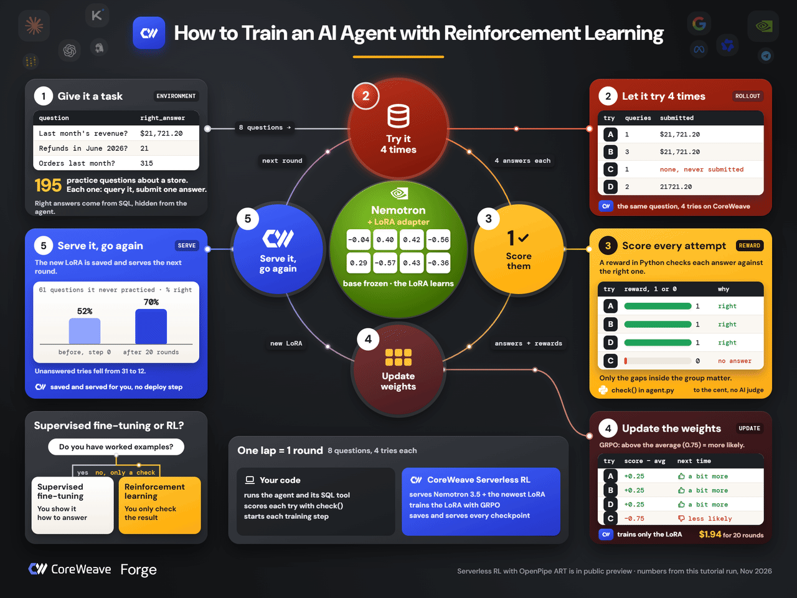
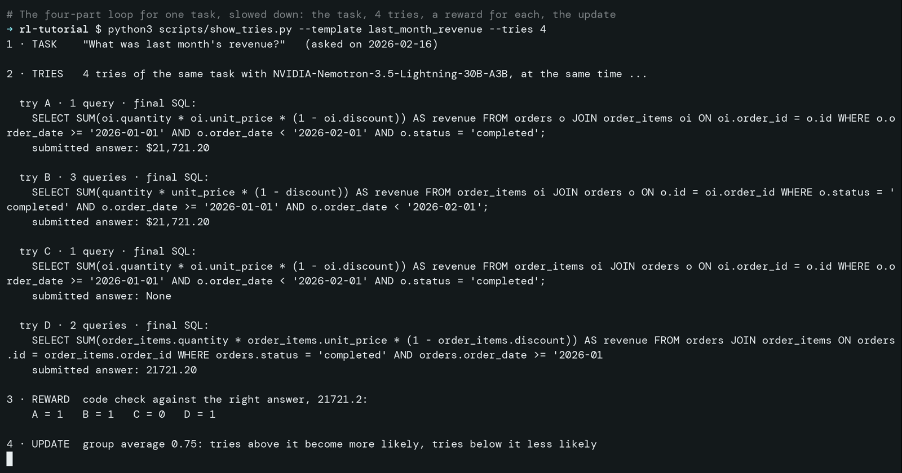
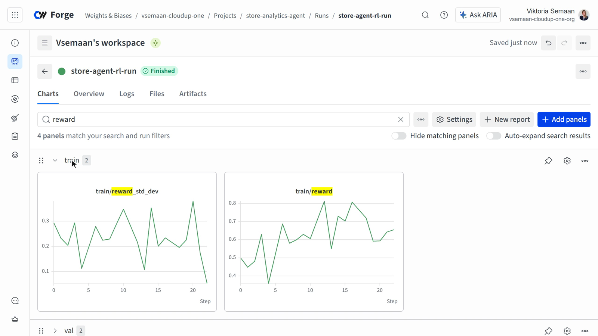
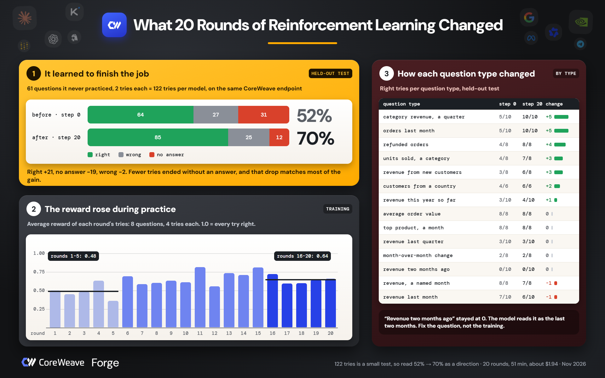

# Train an AI Agent with Reinforcement Learning on CoreWeave

Reinforcement learning trains a model through practice, the way people learn a new skill. The model tries a task,
a check scores each try, and the model changes so the tries that scored well happen more often. Nobody writes the
right answer for it. This tutorial trains a small data analyst agent that answers business questions by writing SQL,
with NVIDIA Nemotron 3.5 Lightning as the model and CoreWeave Forge Serverless RL doing the training.

<p align="center"></p>

On 61 held-out business questions, 2 tries each, the agent answered **52% correctly before training and 70% after
20 rounds of practice**, on the same CoreWeave endpoint. The biggest change was a habit: tries that never submitted an
answer fell from 31 to 12. Training took 51 minutes and cost about $1.94, covered by the Free plan's $500 W&B Training
allowance.

## What you'll learn

1. **How the reinforcement learning loop works:** a task, several tries, a reward for each try, and an update.
2. **How to write a reward in code,** so you never need example answers.
3. **How to train on CoreWeave Forge Serverless RL** with OpenPipe ART, and follow the reward in Forge.
4. **How to test the trained agent fairly** on questions it never trained on.

## How it works

The agent is a data analyst for a small online coffee and tea store. It gets a question ("What was last month's
revenue?") and the date it is asked, queries the store's SQLite database with a `run_sql` tool as often as it needs,
and ends by calling `submit_answer`. Each training step runs the loop once:

1. **Task.** Take 8 questions from the training set.
2. **Tries.** The current model answers each question 4 times on CoreWeave Serverless Inference. The tries differ,
   because the model doesn't answer the same way every time.
3. **Reward.** A code check compares each submitted answer with the answer of a reference query: 1 if it's right,
   0 if not. The model never sees the reference answer.
4. **Update.** CoreWeave Serverless RL compares each try with the average of its group of 4. Tries above the average
   become more likely, tries below it less likely. That small change to the model is the training step.

Then the updated model takes the next 8 questions. A question where all 4 tries score the same teaches nothing, so
the model learns most from questions it sometimes gets right and sometimes gets wrong. This method is GRPO (group
relative policy optimization), and it trains a small LoRA adapter on top of the frozen base model.

## When to use reinforcement learning

| Your situation | Use | Why |
|---|---|---|
| You have examples of the right answer | Fine-tuning (SFT), see the [fine-tuning tutorial](../Fine-Tune%20an%20Open%20Model%20Tutorial/) | Learning from examples is faster and cheaper |
| You can check whether an answer is right, but writing the right answer for every case is hard | **Reinforcement learning** | The model learns from scores, not examples |
| The result is open text, like a summary or an alert | Reinforcement learning with an AI judge (ART's RULER) | A judge ranks the tries in each group |
| The model doesn't know your facts | RAG: put the facts in the prompt | Training would freeze facts that change |

This tutorial's reward is a code check, because a SQL answer is either the right number or not.

## Prerequisites

- A CoreWeave Forge account and API key in `~/.config/coreweave/forge_key`. Your Forge key is also your W&B key.
- **A Models seat in Forge.** Serverless RL logs every run to W&B Models. In Forge, open your account menu → Users,
  and set your Models seat to **Full** (the Free plan includes 5 seats).
- Python 3.10 or later and [uv](https://docs.astral.sh/uv/) (or pip).
- Optional: the gateway from the [Market Watch Agent Tutorial](../Market%20Watch%20Agent%20Tutorial/), which the
  evaluation uses to count spend against a monthly budget. Without it, set `GATEWAY_URL` to any OpenAI-compatible
  endpoint that serves the model (see Step 3).

All commands run from this folder (`Reinforcement Learning for AI Agents Tutorial`).

```bash
uv venv ~/rl-venv && uv pip install --python ~/rl-venv/bin/python openpipe-art wandb pyarrow
source ~/rl-venv/bin/activate
```

## Step 1 · Build the store database

```bash
python3 scripts/make_store_db.py
```

```text
customers       520 rows
products         34 rows
orders        7,125 rows
order_items  14,304 rows
orders from ('2025-01-05 06:53:12', '2026-11-14 23:58:56')
wrote data/store.db (0.6 MB) · today is 2026-11-15
```

The data comes from a fixed seed, so you get the same numbers. Revenue has a few details an analyst has to get right:
each order has a status (completed, refunded, cancelled, pending), each item a quantity, a price and a discount.

## Step 2 · Write the tasks

```bash
python3 scripts/make_tasks.py
```

```text
543 possible tasks in 14 kinds -> 195 for training, 61 held out for testing
```

Each task is a question, the date it is asked, and the answer of a reference query. 14 kinds of questions: revenue in
a month, last month, two months ago, last quarter, so far this year, by category and quarter, average order value,
refunded orders, units sold, top product, month-over-month change, new customers' revenue, and customers by country.
The 61 test tasks are held out and never used for training.

The reward is the `check()` function in `scripts/agent.py`: it reads the first number in the submitted answer and
compares it with the reference (to the cent for money, exactly for counts, to 0.1 for percents), or looks for the
product name. Right = 1, wrong = 0.

## Step 3 · Measure the base model

```bash
python3 scripts/evaluate.py --model nvidia/NVIDIA-Nemotron-3.5-Lightning-30B-A3B --label base --tries 2
```

Each of the 61 test tasks runs twice, and the script prints a table by kind of question. Calls go to
`http://127.0.0.1:8787/v1` (the gateway from the first tutorial); set `GATEWAY_URL` to use another endpoint.

```text
base: 73 of 122 correct = 60% · 0 failed calls · 71 s · saved results/eval-base.jsonl
```

60% is the score to beat. Most misses weren't wrong numbers: in 35 of the 49 misses the model never called
`submit_answer`, it ran out of turns or answered in plain text. Year-to-date revenue was the hardest kind (1 of 10): the
model summed every order up to today instead of starting on January 1.

## Step 4 · A tiny training job first

```bash
export WANDB_API_KEY=$(cat ~/.config/coreweave/forge_key)
python3 scripts/train_rl.py --steps 1 --groups 2 --val-every 0 --name store-agent-rl-smoke
```

One step with 2 tasks and 4 tries each, to check that everything works and to see the time per step. The script
registers a trainable model on `nvidia/NVIDIA-Nemotron-3.5-Lightning-30B-A3B` with ART's `ServerlessBackend`, runs the
tries, prints the 4 tries of the first task with their reward, and trains one step:

```text
  task: "What was last quarter's revenue?" (today 2026-07-19) · right answer 72946.15
    try A: reward 1 · answer 72946.15       · SELECT SUM(quantity * unit_price * (1 - discount)) AS revenue FROM order_items JOIN orde
    try B: reward 1 · answer 72946.15       · SELECT SUM(quantity * unit_price * (1 - discount)) AS revenue FROM order_items JOIN orde
    try C: reward 0 · answer None           · SELECT SUM(quantity * unit_price * (1 - discount)) AS revenue FROM order_items WHERE ord
    try D: reward 0 · answer None           · SELECT order_date, status FROM orders WHERE status='completed' ORDER BY order_date ASC L
  reward: average 0.75 over 8 tries · 1 of 2 tasks had right and wrong tries
  update: Serverless RL trained step 1 in 190 s (tries took 21 s)
```

That's the whole loop in a few lines: the same question, four different tries, a score for each, and an update.

To watch one loop for one task without training anything, run `python3 scripts/show_tries.py --template last_month_revenue`:

<p align="center"></p>

## Step 5 · Train

```bash
python3 scripts/train_rl.py --steps 20
```

20 steps of 8 tasks x 4 tries. Every 5 steps the script checks the new model on 20 held-out test tasks and logs the
result as `val/reward`. When it finishes, it prints the checkpoint's model name and saves it to
`data/trained_store-agent-rl.json`.

```text
step 20: 8 tasks x 4 tries on Serverless Inference ...
  reward: average 0.66 over 32 tries · 1 of 8 tasks had right and wrong tries
  update: Serverless RL trained step 20 in 32 s (tries took 8 s)
  check: 12 of 20 held-out test tasks right with the step 20 model
```

The whole job took 51 minutes: about 5 minutes of tries and 46 minutes of training updates (30 s to 3 min per step).
The average reward per step moved from 0.36–0.63 in the first five steps to 0.59–0.81 in the last ten. It's noisy,
because every step sees 8 different questions. About 15% of tries hit transient API errors; ART leaves those out of the
step instead of scoring them 0, and the script prints how many.

Follow the run in Forge: Weights & Biases → `store-analytics-agent` → `store-agent-rl-run` → Charts, and search for
`reward`. `train/reward` is the average reward per step, and `val/reward` is the 20-task check every 5 steps.

<p align="center"></p>

## Step 6 · Test the trained model

Every checkpoint is hosted on CoreWeave as soon as it's saved, so you can call it right away by its name:

```bash
python3 scripts/evaluate.py --model "wandb-artifact:///<your-team>/store-analytics-agent/store-agent-rl-run:step20" --label rl --tries 2
```

Then test the untrained checkpoint on the same endpoint, for a like-for-like before and after:

```bash
python3 scripts/evaluate.py --model "wandb-artifact:///<your-team>/store-analytics-agent/store-agent-rl-run:step0" --label step0 --tries 2
```

## Step 7 · Compare

```bash
python3 scripts/results.py --labels base step0 rl
```

```text
task kind                      base*       step0          rl
avg_order_value                4 of 8        8 of 8        8 of 8
category_quarter               4 of 10       5 of 10      10 of 10
country_customers              6 of 6        4 of 6        6 of 6
last_month_orders              7 of 10       5 of 10      10 of 10
last_month_revenue             6 of 10       7 of 10       6 of 10
last_quarter_revenue           4 of 10       3 of 10       3 of 10
month_over_month               5 of 8        2 of 8        2 of 8
new_customer_revenue           4 of 8        3 of 8        6 of 8
refunded_orders                7 of 8        4 of 8        8 of 8
revenue_month                  5 of 8        8 of 8        7 of 8
top_product                    7 of 8        8 of 8        8 of 8
two_months_ago_revenue         8 of 10       0 of 10       0 of 10
units_category                 5 of 8        4 of 8        7 of 8
year_to_date_revenue           1 of 10       3 of 10       4 of 10

correct                          60%         52%         70%
```

| | Before (step 0) | After (step 20) |
|---|---|---|
| Correct answers | 64 of 122 (52%) | **85 of 122 (70%)** |
| Tries that never submitted an answer | 31 | **12** |
| Output tokens per try | 221 | 214 |

<p align="center"></p>

How to read it:

- **Compare `step0` with `rl`.** Both run on the training endpoint that hosts your checkpoints. `base` runs on
  CoreWeave Serverless Inference, which serves the same model differently, so it isn't a like-for-like baseline. To
  get the step-0 score, evaluate `…/store-agent-rl-run:step0` the same way as step 20.
- **What improved:** finishing the task. The trained model submits an answer far more often, and it got every
  category-by-quarter, last-month-orders and refunded-orders question right.
- **What didn't:** "revenue two months ago" is 0 of 10 at step 0 and at step 20 on this endpoint. The model reads it
  as the last two months, not the single calendar month two months back. That's an ambiguous question, so fix the
  question or the instructions rather than training harder.
- 122 tries is a small test. Read 52% → 70% as a clear direction, not an exact rate.

## Cost

| What | Cost |
|---|---|
| Serverless RL training (smoke runs + 20 steps) | about $1.94, within the Free plan's $500 W&B Training allowance |
| Inference for the tries during training | included in training |
| Evaluations through the gateway (3 x 122 tries) | about $0.20 of Serverless Inference |

Serverless RL bills $2.70 per hour of active training, and idle time is free. Check Forge → account → Billing →
W&B Training for your own total.

## Troubleshooting

| Error | Cause | Fix |
|---|---|---|
| `400 LoRA inference requires an explicit checkpoint ... :stepN` | The tries asked for the model without a step | Call `model.get_inference_name(step=...)` with the current step (the script does) |
| `No module named 'pyarrow'` when logging a step | ART saves each step's tries as a Parquet file | `uv pip install pyarrow` |
| `No module named 'wandb'` | ART uploads to W&B | `uv pip install wandb` |
| Registering the model times out (HTTP 524) | Your Forge Models seat is "No access" | Forge → account menu → Users → Models seat: Full |
| Every task in a step has the same reward for all tries | The tasks are too easy or too hard for the model | Nothing to learn from those; mix in tasks the model sometimes gets right |

## Files

| File | What it does |
|---|---|
| `scripts/make_store_db.py` | Builds `data/store.db` from a fixed seed |
| `scripts/make_tasks.py` | Writes the training and test tasks with their reference answers |
| `scripts/agent.py` | The agent (prompt, `run_sql` and `submit_answer` tools, the episode loop) and the reward `check()` |
| `scripts/evaluate.py` | Scores any model on the test tasks through the gateway |
| `scripts/train_rl.py` | The training loop on CoreWeave Serverless RL |
| `scripts/show_tries.py` | One loop for one task: 4 tries, their SQL, answers and rewards |
| `scripts/results.py` | Before vs after, plus the reward per training step |
| `results/` | Every evaluation and the training log |
